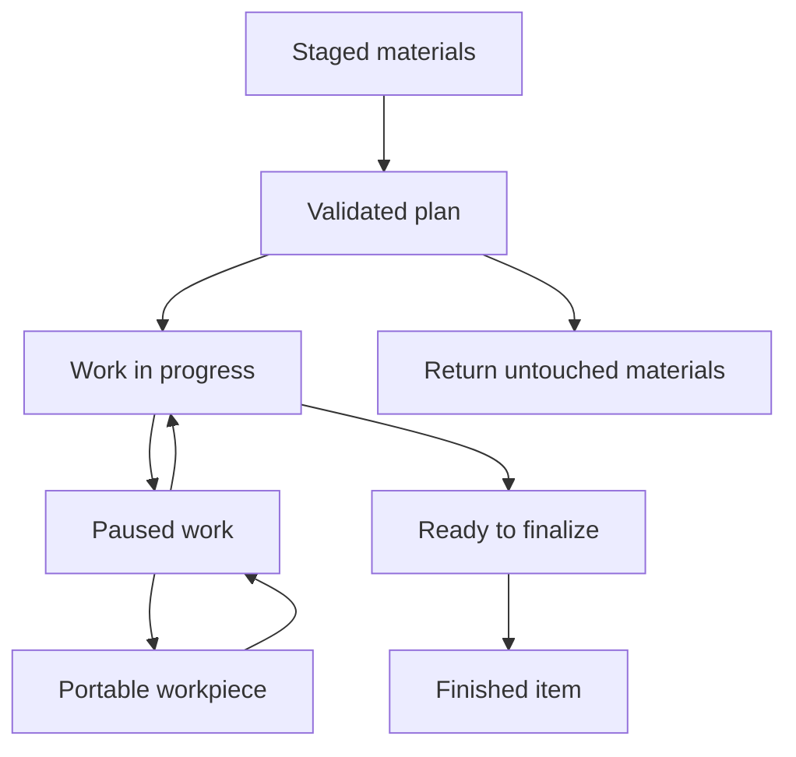

# Immersive Jewelry — Cinematic, Hands-On Overhaul

**Implementation handoff · 14 November 2026**

**Target:** [otectus/ImmersiveJewelry](https://github.com/otectus/ImmersiveJewelry), Minecraft 1.20.1, Forge, Java 17.

**Design reference:** [Pocky-l/handson-delight](https://github.com/Pocky-l/handson-delight), including its underlying [Diegesis](https://github.com/Pocky-l/diegesis) library.

## 1. Your assignment

Rebuild Immersive Jewelry around working with the actual objects on its workstations. The player should lean over a lapidary wheel, guide a mounted stone against its abrasive surface, inspect the emerging facets, place that stone into a frame, close its setting with a visible tool, and finish the metal by hand.

The owner explicitly authorizes replacing the current minigames and other aspects of the mod. Treat this as a gameplay, interaction, rendering, animation, audio, and persistence overhaul. Moving the existing buttons and pressure gauges onto a floating panel does not fulfill the brief.

Implement the complete plan through the release gates. The first ring is a vertical slice used to establish quality; it is not the finished overhaul.

### Product decisions

- Keep the Lapidary Wheel and Jeweler’s Bench as the two core stations. Make each a richly interactive workstation rather than adding a separate block for every small operation.
- Make direct interaction in the world the default crafting experience. Use menus for reference, configuration, equipment, and optional assistance where they help.
- Use Diegesis as the preferred camera and scene interaction foundation, behind a small Jewelry-owned adapter. Jewelry continues to own crafting rules, material custody, quality, and effects.
- Replace abstract pointer tracking and hold-to-hit-a-meter gameplay with visible contact, alignment, deformation, coverage, and inspection.
- Make work resumable. Leaving a workstation preserves progress, material consumption, and mistakes already made.
- Retain the four jewelry forms, four cuts, three finishes, current designs, gem/material definitions, equipment integrations, and public extension points.
- Keep metal blank production in Immersive Smithing when available, with the existing fallback path when absent. This overhaul concentrates on lapidary work and fine jewelry assembly; do not duplicate the sister mod’s forge and anvil pipeline.
- Make routine crafting comfortable. Precision should improve a result, while readable, forgiving interactions produce usable jewelry.

These decisions supersede the older development specification wherever it mandates workstation minigame screens, instantaneous finishing, or rollback-on-cancel behavior. Update the specification and architecture documentation alongside implementation.

## 2. Verified starting point

### 2.1 Source snapshot and limits

The following public source snapshots were inspected for this handoff:

| Repository | Inspected branch and commit | Relevant baseline |
|---|---|---|
| Immersive Jewelry | `main` · `11a6a65c5031df80829a143431850eec308319c6` | Declares mod 1.1.2, Minecraft 1.20.1, Forge 47.4.23, Java 17; network protocol `2` |
| Hands-On Delight | `main` · `54697d517938fa9a5876b4a65ab2a38abf331952` | Station definitions, client behaviors, tool strokes, and Diegesis integration |
| Diegesis | `main` · `7b9b343b49c31bbaf56e2b078668166fb7e5a068` | Source declares `1.0.0-beta.9`; public camera, scene, state, storage, and interaction APIs |

This is a source-informed design and implementation specification. The inspected projects were not built or playtested for this document. Repository source versions do not establish which published dependency binary contains every inspected API. Verify that mapping in milestone 0.

At implementation time, record the actual checkout and compare changes since these commits. Read `CLAUDE.md`, `MODMAP.md`, `docs/ARCHITECTURE.md`, `docs/Immersive_Jewelry_Development_Spec.md`, and `docs/WORKSTATION_VALIDATION.md`. Prefer executable source over stale generated inventories when they disagree. [S1–S3]

### 2.2 What already exists

Paths below are relative to `src/main/java/com/otectus/immersivejewelry/` unless otherwise stated.

| Existing system | Observed implementation | Overhaul instruction |
|---|---|---|
| Physical placement | `minigame/StationInteractions.java` already mounts stones and laps and places blanks or jewelry in block entities | Preserve material custody; extend placement to identifiable areas and tools |
| Selection screens | `client/screen/CutSelectScreen.java`, `BenchScreen.java` | Replace the normal workflow with specimen templates, a design folio, socket placement, and tool selection at the station |
| Crafting screens | `CuttingScreen.java`, `SettingScreen.java`, `MinigameScreen.java` | Retire as default crafting frontends; extract useful input, feedback, and simulation plumbing |
| Cutting | `minigame/cutting/CutSimulation.java` tracks contact, drift, pressure, heat, facet completion, and damage | Retain deterministic evaluation concepts; replace the abstract contact interface and time pressure |
| Setting | `minigame/setting/SettingSimulation.java` evaluates balanced pressure on setting points | Replace automatic point progression with visibly selected prongs and physically distinct bezels |
| Session authority | `SessionManager.java` validates inputs, replays simulations, and finalizes results | Refactor into transient operator sessions plus persisted work orders |
| Persistence | Wheel holds the stone; bench holds workpiece and escrow; old bench escrow is dropped on reload if its session is gone | Introduce explicit new-format resumable work and a separate migration path for old orphaned escrow |
| Rendering | `JewelersBenchRenderer.java` renders the piece and a hovering stone; `LapidaryWheelRenderer.java` spins a separate disc and trembles a mounted stone | Replace illustrative motion with task-driven, spatially correct objects and tool contact |
| Repair and finish | `StationInteractions.repair` and `refinish` spend materials and apply changes immediately | Replace these menu actions with short physical operations using the same validated economics |
| Jewelry identity | `api/gem/GemData.java`, `api/jewelry/JewelryData.java`, `BlankData.java` | Preserve gem identity, workmanship history, integrity, reworks, maker, and Smithing data |
| Extensibility | Definition loaders, `JewelryDesignRecipe`, API gates/events/contributors | Make new interactions consume these systems instead of bypassing them |
| Existing tests | Unit tests, GameTests, shared reference bots, client smoke tests, resource generators | Extend them to the new interaction and persistence contracts |

The issue is not a complete absence of world interaction. The current physical setup leads into screen-based execution, while the world mostly displays a summary. The overhaul must make the world object itself the thing being worked. [S4–S9]

### 2.3 What to take from Hands-On Delight

Use the reference’s relationship between action and object: a tool moves through the material, the material changes where the tool touches, and other players see the work. Its station/behavior split and Diegesis-backed scenes are useful implementation examples. Its recipe support also illustrates why existing recipe data should remain authoritative. [S10]

Adapt those principles to a jeweler’s small, deliberate movements. Avoid copying cooking gestures, food physics, reward stars, or batching rules into jewelry. A stone has individual appraisal and damage data; a stack of stones must not become sixteen identical high-quality results from one gesture.

## 3. The experience to build

### 3.1 A first piece, from the player’s perspective

1. Place a diamond on the Lapidary Wheel. It becomes the same persistently appraised stone used by the current mod. A small label describes its size and clarity.
2. Right-click the work surface. The camera eases toward the mounted stone while the surrounding workshop remains visible.
3. Pick a round-cut specimen from a small template rack. Its silhouette appears as a thin guide over the stone, with the expected size loss explained before work begins.
4. Take the quill handle. Rotate its index collar, guide the selected face toward the wheel, and make a controlled grinding pass. A flat face emerges precisely where the stone meets the lap.
5. Lift the handle to stop cutting. The grinding sound fades, slurry settles, and the new face catches the light. Use the loupe to inspect it, then continue.
6. Lift the finished gem into the material tray. Bring it to the bench through a real inventory transfer or direct hand placement.
7. Place a ring blank in the padded clamp and select the solitaire pattern from the design folio. Seat the gem in its cup with tweezers.
8. Take the pliers. Close opposing prongs by moving the tool handles; the jaws and prongs visibly follow. The stone stops rocking as the setting becomes secure.
9. Apply polishing compound and wipe around the ring. The polished area follows the cloth rather than appearing all at once.
10. Tilt the finished ring on the inspection pad. A concise description identifies its quality and any remaining defect. Take it and wear it.

This whole route must work without opening any of the current cut-selection, bench-selection, cutting, or setting screens.

### 3.2 Pacing targets

These are proposed playtest targets, not descriptions of current timings. Measure active work separately from reading and inspecting.

| Work | Initial target |
|---|---:|
| Enter or leave focus | 0.3–0.5 seconds; instant option |
| Familiar simple cut | 20–40 seconds |
| Intricate brilliant cut | 35–60 seconds |
| Seat and secure one stone | 12–25 seconds |
| Finish a small piece | 5–10 seconds |
| Three-stone assembly | 30–60 seconds, excluding separately cutting the stones |
| Routine retightening or refinishing | 5–15 seconds |

Do not require idle waiting, rapid clicking, every real-world facet, repeated dipping, or a timed flourish after every substep. Add mastery through choice and control, not endurance. Leave inspection time unlimited.

## 4. A consistent interaction language

### 4.1 Walk-up use and focused work

Walk-up actions remain useful: place a stone, install a lap, place a frame, take an unlocked finished item, or inspect a station’s contents. Focus is the precision interface, entered by interacting with the work area rather than forced on every item placement.

Recommended default mapping:

| Action | Default interaction | Required behavior |
|---|---|---|
| Enter focus | Right-click an unoccupied station work area | Server authorizes use before input becomes active |
| Pick or place | Click an object or valid tray position | Use click-to-pick/click-to-place; drag also supported |
| Use a tool | Select its visible handle, then act on the workpiece | Cursor and contact preview identify the exact target |
| Apply force | Move the selected handle along its constrained axis | Actual handle travel determines force; no pretend mouse pressure |
| Rotate work | Dedicated rotate input or wheel while over the rotation control | Do not rotate the player or change hotbar slots during focused work |
| Inspect | Click the loupe or use a rebindable inspect key | No material change and no time penalty |
| Open supplies | Dedicated inventory/drawer input, such as Tab | Only opens on request; expose all inventory when desired |
| Put tool down | Secondary action | Ends force/contact immediately |
| Leave | Escape; movement can also exit | Release tools, checkpoint work, restore normal controls |
| Switch nearby station | Explicit station control or rebindable input | Allowed only after contact stops and the server grants the new station |

Provide a small contextual hint with the bound key and a verb: “Lift away,” “Close this prong,” “Turn the stone,” “Polish this edge.” Do not put implementation terms, packet status, or quality equations into the normal player flow.

### 4.2 Real objects and inventory rules

- Loose gems, blanks, consumables, and outputs are real server-owned stacks. Their scene models are projections of those stacks.
- Built-in fixtures—clamp, quill, loupe, cloth, and a basic bezel tool—can be part of the station. They do not need to become separately crafted inventory items just to justify an animation.
- Continue requiring actual Jeweler’s Pliers or Fine Pliers for operations governed by their quality. The visible tool must correspond to a validated inventory or docked-tool stack.
- Docking a real tool transfers custody to a station slot. A client visual copy grants no tool use. Dropping, moving, breaking, or swapping that tool must be handled deterministically.
- Click-to-stage from the folio is optional convenience: show missing ingredients, obtain exact stacks on the server, and place them visibly into trays. It must never start work or substitute an appraised stone silently.
- A rejected placement gives a brief reason and leaves the item in its original authoritative location.
- Never empty the player’s hand into an arbitrary slot just because focus opened.
- Finished pieces wait on the pad until collected. They do not teleport into inventory as an obligatory completion effect.

### 4.3 Supplies and design selection

Add a small physical design folio, cut-specimen rack, and sorted material tray. They are entry points to decisions, not mandatory popups between every operation.

The folio supports known designs, favorites, form filters, and a readable close-up page. It shows required stones, cut restrictions, finish choices, and the source of an unavailable sketch. JEI may open the relevant page or stage a validated selection; it must not craft the result.

Inventory drawers may use familiar slots and text. Make them contextual and user-invoked. Do not cover the active workpiece with a permanent inventory grid.

## 5. Camera, hands, and cinematic direction

### 5.1 Camera contract

Cinematic means deliberate framing and readable material change, not taking control for a long cutscene.

- Author an overview shot and an optional inspection shot for each station. The bench favors an oblique view of the clamp; the wheel favors a three-quarter view showing the quill, contact patch, and abrasive disc together.
- Start with roughly 45–55 degrees vertical field of view and tune against actual geometry. These are framing targets; do not change the saved player FOV setting.
- Use eased position and orientation transitions with no roll. Keep the horizon and nearby workshop recognizable.
- Keep the camera steady during a precision stroke. A small tool recoil can occur without shaking the camera.
- Magnify by moving or narrowing the local view, or by a clearly presented inspection inset. Do not secretly enlarge the world object only for the operator while applying different hit geometry.
- Keep the player’s real body at its legitimate position. Camera travel never changes interaction reach, permissions, collision, or line of sight.
- Collision-check the destination and transition. Use a closer or side shot when a wall or low ceiling blocks the preferred view; fall back to a stationary accessible view when necessary.
- Disable Diegesis’s default block-clearing effect for these scenes. Hidden walls must not become a way to inspect or interact through the workshop. Do not fade hostile entities out of awareness.
- Neighbor transitions are deliberate and off by default for edge hovering. Disable the library’s default movement-key neighbor routing if those keys are used for exit or accessible tool controls.
- No transition while applying force, dragging a real stack, or carrying a tool. Switching requires a clean checkpoint and new authorization.
- Resize, GUI scale changes, ultrawide windows, 4:3, and high-DPI rendering must preserve both framing and hit mapping.

### 5.2 Entering and exiting safely

On enter, retain the camera mode, FOV context, mouse capture state, relevant HUD state, and input ownership. On every exit path, restore them exactly once. Handle Escape, damage, death, respawn, teleport, dimension change, disconnect, server rejection, station removal, resource reload, another screen opening, and loss of window focus.

Damage or displacement immediately releases tool contact and exits focus. Losing window focus releases all held actions and suspends work. The surrounding world continues normally; no invulnerability or global slow motion is introduced.

After exit, consume the release event that belonged to the station so it cannot mine the block, attack a bystander, or drop an item. Camera recovery must not depend on a successful network round-trip.

### 5.3 Hands and tools

Use restrained Minecraft-style hand/forearm poses to anchor delicate actions: one hand steadies the quill or frame, the other operates the tool. Support the player’s main arm, skin, sleeve layer, and standard/slim arm geometry. Provide a tool-only option for players or model mods that cannot use the hand presentation cleanly.

Prioritize visible tool tips and contact over elaborate arm rigs. Author local poses for picking up, hovering, contacting, applying force, releasing, and setting down. A small procedural solver or authored pose blends are sufficient; do not make a full-body IK or animation library a prerequisite.

Hide only the conflicting vanilla first-person hand while Jewelry owns that presentation. Do not render the same tool both as a carried stack and as an animated tool. Other players must at least see the correct shared tool pose, material change, and progress; optional avatar arm detail can be simpler.

### 5.4 Short visual beats

| Moment | Visual treatment | Input rule |
|---|---|---|
| Mount stone | Clamp closes; stone settles onto the holder | Short interruptible settle |
| Start grinding | Disc reaches speed; contact produces localized dust/slurry | Contact begins only after the player acts |
| Complete a facet | New flat catches a moving highlight | Keep control; no result popup |
| Seat stone | Stone fits into the cup; subtle change in contact sound | Alignment determines the seat |
| Close prong | Jaw follows handle, prong bends toward the stone | Visible deformation and server evaluation agree |
| Finish surface | Cloth reveals sheen or clears patina from high points | Coverage follows the tool |
| Complete piece | Clamp relaxes; piece rests on inspection pad | Optional tilt, immediately skippable |

## 6. Lapidary Wheel overhaul

### 6.1 Layout

Retain the existing block identity, facing, and lap upgrade identities. Rework its model into separable authored parts: disc, axle, quill/dop holder, index collar, guide rest, stone, small cooling/slurry basin, specimen rack, loupe, and output tray. Keep the block footprint practical in a small workshop.

The default base abrasive remains usable without an installed upgrade. Emery and Diamond Laps continue to improve their configured handling and durability behavior. Do not gate existing basic crafting behind new consumable water or power infrastructure. The basin may be a visible station fixture; additional fluid economics are optional future work.

### 6.2 Appraise, plan, mount

Preserve one-time appraisal on first mounting. Canceling, moving, reloading, or transferring the stone cannot reroll size, natural quality, inclusions, or its random identity.

Before the first abrasive contact, show available cuts as actual example stones or silhouette templates. Indicate whether the selected shape fits the stone and summarize the size/quality tradeoff. A ghost outline must look distinct from the real gem and never be an inventory object.

Changing a plan before work starts is free. After material has been removed, changing the target cut uses a validated recut transition and the current smaller geometry; it cannot restore the original stone or clear accumulated damage.

### 6.3 Grinding interaction

1. Select a facet or working region by rotating the quill’s index collar. Snap to meaningful detents; allow optional fine adjustment.
2. Guide the handle toward the wheel along a constrained path. The mounted stone, not a floating cursor marker, approaches the abrasive.
3. Let handle displacement control contact force. Tangential motion controls the sweep across a face; angle controls alignment.
4. Integrate material removal only while the validated stone surface contacts the wheel. Lifting the handle immediately ends abrasion.
5. Show a thin target boundary on the material and a natural change in sound as the desired depth approaches. Offer an optional numeric guide for accessibility and learning.
6. Rotate to the next region and repeat. The player can choose an allowed sequence; guide recommendations rather than moving automatically after a timer.

Use the existing deterministic simulation framework as a starting point. Replace compulsory cursor drift with small, readable material/tool resistance. Hardness, brittleness, inclusions, lap tier, and assist settings should affect tolerance and removal rate. Never make the tool wander arbitrarily just to create difficulty.

### 6.4 Four cuts that feel different

The current definitions have 6/10/8/4 working facets or regions. Preserve their data and effect identities while changing their physical interpretation. [S7]

| Cut | Physical action | Feedback and distinctive result |
|---|---|---|
| Round | Index around a radial sequence and make even passes | Balanced outline, regular faces, clear symmetry |
| Brilliant | Work smaller crown/table regions with careful depth and angle control | More crisp facets and restrained high-quality sparkle; greater difficulty and size loss |
| Emerald | Make parallel step passes, then work the corners | Rectangular/octagonal silhouette, tiered faces, straight reflection bands |
| Cabochon | Sweep smoothly across broad dome regions | Continuous rounded surface; no fake sharp facets or prong-timing reskin |

Treat these counts as gameplay regions rather than a demand for physically exhaustive gem geometry. Custom datapacks with other bounded counts receive generic layouts and remain craftable.

### 6.5 Material evolution and mistakes

Build gem geometry from a bounded parametric mesh or authored stage shapes with interpolated working faces. The rough stone must visibly become the selected cut. A changing texture or a progress bar alone is insufficient.

Localize scratches, chips, and excess removal to the affected region. Preserve current size-loss and quality-cap concepts. Use subdued heat/contact feedback, not a gemstone glowing like molten steel. Cooling means lifting away or briefly using the visible basin when helpful; do not require a dip after every pass.

Overcutting removes additional material and may reduce attainable quality. Poor angle produces asymmetry or scratches. Sustained excessive contact can chip a brittle stone. All consequences need readable precursor cues and a recoverable path. Keep catastrophic deletion disabled by default.

No global countdown runs while reading, inspecting, or deciding. End when the required regions are acceptably worked, or when the player deliberately accepts a rougher result. Disconnects and missing input must not finish a cut at a failing grade.

### 6.6 Inspection and recutting

The loupe enlarges the existing mesh and its flaws. It reports plain observations such as “Uneven shoulder” or “Scratched table.” It does not replace the stone with a separate perfect preview.

Recutting starts from the saved stone, follows the existing gem damage and size rules, and can reduce flaws at a cost. An unfinished cut can be taken as the same work-bearing stone and resumed later. Completion creates one authoritative cut stone and applies lap wear and cut events once.

## 7. Jeweler’s Bench overhaul

### 7.1 Layout and preparation

Model a padded central clamp, ring mandrel, interchangeable form supports, numbered gem tray positions, tool dock, folio, finishing pad, and small loupe. Supports are built into the bench and change visibly with the selected form; they do not require four benches.

Place the frame, choose a known design, stage the required stones, then clamp it. Preview socket locations and compatibility directly on the piece. A stone that cannot fit gets a brief explanation before any material is committed.

Validate the full design, all stones, and the craft gate before the first irreversible assembly operation. Keep the current rule that a multi-stone piece uses stones of the same gem species. Mixed-gem effects are a separate systemic expansion and must not slip into the overhaul without an explicit trait-resolution design. Preserve each stone’s individual cut, quality, size, and damage.

### 7.2 Seating

Pick a stone with the visible tweezers and move it over a socket. A soft alignment guide appears only near a valid socket. Use a forgiving capture region; this should not become pixel-perfect drag-and-drop.

Alignment, orientation, and suitability determine seating. Rotate when useful, lower into the cup, and release. Before any prong or bezel is closed, a poorly seated stone can be lifted and repositioned without destroying it. Distinguish temporarily resting in a socket from mechanically secured.

Multiple stones retain their socket identity. The first/principal stone remains well defined for effects and display. Show remaining sockets and keep unused tray stones untouched.

### 7.3 Prong settings

Select an actual prong by touching it with the pliers’ jaws. Drag the handles along a constrained closing axis. The tool and prong deform together, and the visible gap between prong and stone narrows.

Use an opposing-prong sequence as guidance. Evaluate final contact, symmetry, and excess deformation. The player should be able to release, inspect, and correct a loose prong. Do not force them to wait for a sweeping meter or execute a random timing sequence.

Make error states physically legible: a loose prong leaves a gap, an overbent prong leans inward, an uneven setting tilts or rocks, and a cracked stone shows the damaged edge. Add a quiet tactile sound at secure contact. Feedback must also work with sound or color disabled.

Keep Fine Pliers’ identity as a handling/tolerance improvement. They should not silently generate superior workmanship without competent work.

### 7.4 Bezel settings

Bezel work must have a different gesture and model. Use the bench’s burnisher or setting tool to push sections of a continuous rim inward, then sweep around the rim to even it out.

Track angular sector coverage, deformation, and balance. A narrow bright rim and changing contact highlight show what remains. Excess pressure in one sector visibly pinches or distorts the bezel. Do not render a bezel as invisible prongs operated with the same squeeze minigame.

The existing design points can seed the logical sectors. Do not require changing old datapacks merely to use the new gesture.

### 7.5 Cover every existing design

All IDs in the next table are under `immersive_jewelry:designs/`. Current stone counts and setting point counts are shown; retained allowed cuts, protection, sketch requirements, and tightness come from each recipe. [S7]

| Design | Existing setting | Required physical treatment |
|---|---|---|
| `solitaire_ring` | 1 stone, 4 prongs | Small ring clamp; opposing jaw contacts |
| `bezel_ring` | 1 stone, 6 bezel sectors | Mandrel rotation and continuous rim work |
| `trilogy_ring` | 3 stones, 4 prongs each | Distinct center and shoulder sockets; readable access to each |
| `pendant_amulet` | 1 stone, 6 prongs | Flat padded support; visible bail and frame |
| `locket_amulet` | 1 stone, 8 bezel sectors | Locket-shaped frame and rim; avoid implying a new storage inventory |
| `halo_amulet` | 3 stones, 4 prongs each | Three actual gem instances within a decorative halo profile |
| `cuff_bracelet` | 1 stone, 6 bezel sectors | Curved cuff support and coherent rim contact |
| `link_bracelet` | 3 stones, 4 prongs each | Separate settings along the bracelet; supports shift to expose each |
| `simple_circlet` | 1 stone, 6 prongs | Head-form support; front setting faces the work view |
| `diadem` | 3 stones, 4 prongs each | Symmetric crown layout with selectable stone positions |

Larger forms need different framing and supports, not arbitrarily longer repetition. Do not add individual chain-link assembly as a required chore.

## 8. Finishing, reworking, and ownership of a finished piece

### 8.1 Make all three finishes physical

| Existing finish | Action | Visible transformation | Economy |
|---|---|---|---|
| Polished | Apply compound and wipe overlapping arcs around exposed metal | Sheen follows coverage; recesses retain depth | Preserve the current polishing-compound cost |
| Burnished | Run a smooth tool across the frame in controlled passes | A softer, directional satin finish develops | Preserve the current no-consumable baseline unless balancing is explicitly revised |
| Antique | Apply the game’s patina treatment, then wipe the high points | Dark recesses and brighter raised edges | Preserve the current data-defined gunpowder cost as a game abstraction |

Retain each finish’s existing mechanical identity and multipliers. Physical finishing replaces the choice-only application; it does not require inventing a new power system.

Use a small bounded surface-coverage representation per frame, with material-aware regions and a rotated view where needed. Repeatedly rubbing one spot must not finish the whole item. Ignore excessive input frequency; progress depends on newly covered surface and valid contact.

Finishing is short, forgiving, and resumable. On reaching sufficient coverage, the finish takes effect. Extra precision may refine the cosmetic uniformity, but the initial overhaul must not add an unplanned fourth multiplicative power score. An unfinished assembly remains an inert workpiece until its chosen finish is complete.

Optional engraving can add a small authored maker’s mark or pattern on the frame. Keep it cosmetic, bounded, and data-driven; do not turn release completion into a freehand vector-editor project.

### 8.2 Repair, retighten, remove, and refinish

- **Retighten:** highlight the actual loose contacts and let the player correct them. Preserve the relevant defect and quality rules; do not grant new crafting experience repeatedly.
- **Repair:** stage the existing material cost, support the damaged frame, and use a few visible alignment/burnishing passes. Preserve integrity restoration and the rework cap. This is minor restoration, not an alternative forge.
- **Remove stones:** select a socket, loosen its prongs or bezel, and lift the stone into a real tray slot. Preserve gem damage and frame integrity consequences. If supporting partial removal, persist exactly which stones remain; otherwise stage removal of all sockets as one resumable operation before converting to a blank.
- **Refinish:** apply the selected finish physically and replace the previous finish’s effects only at successful completion. Keep its costs and design restrictions. Do not stack old and new finish multipliers.
- **Recut:** return the removed gem to the wheel with its actual remaining size and defects.

No extraction animation may duplicate the stone that is still embedded in the canonical jewelry data. Every operation needs a defined single ownership transition.

### 8.3 Finished-piece identity

Show the actual cut, setting silhouette, finish, and defects in the final item’s presentation. Use shared material palettes and geometry across station close-ups, inventory/hand views, and inspection displays where practical. Avoid a detailed three-stone assembly becoming a one-stone generic sprite.

Retain concise tooltips, maker identity, and advanced numeric details on demand. Preserve existing custom names, enchantments, external affixes, Smithing data, and integrity. A close-up inspection view is enough for the core release; optional worn ring/bracelet/amulet/circlet layers should use Curios and built-in slots consistently and degrade cleanly under armor or player-model replacements.

## 9. Quality, progression, and accessibility

### 9.1 Preserve the underlying economy

The current workmanship calculation is a normalized weighted sum of Smithing, cutting, and setting quality, with default weights 0.35/0.35/0.30. Preserve that contract initially. New interactions should produce trustworthy cutting and setting values; cosmetic polish must not accidentally multiply power again. Existing finished pieces retain the workmanship stored when they were made. [S8]

Evaluate performance from meaningful physical outcomes:

| Process | Evaluate | Do not reward |
|---|---|---|
| Cutting | Shape accuracy, symmetry, unnecessary material loss, damage | Mouse polling rate, FPS, camera FOV, packet volume |
| Prongs | Seating, secure contact, balanced deformation, remaining defects | Number of clicks or speed of clicking |
| Bezels | Rim coverage, balanced closure, excessive compression | Sweeping repeatedly over a single completed sector |
| Finishing | Sufficient valid surface coverage | Endless polishing for limitless stats |

Keep quality caps, natural gem limitations, integrity, and rework costs meaningful. Practice should help the player understand and control the process. Do not add an unrelated skill tree when `IJewelryAssistSource` and the existing craft/wear gates already support external progression.

Preserve sketch knowledge and the Jeweler profession. Advanced designs still require the configured learning path, and villager-produced jewelry retains its configured workmanship cap. Optional instructional work orders or commissioned designs can reuse this progression later; they are not prerequisites for finishing the core overhaul.

### 9.2 Accessible controls are a required frontend

Implement both direct pointer manipulation and an assisted control method using the same server operations. In assisted mode, the player can select a working region, nudge a handle or angle with keys, and apply/release contact with a single rebindable input. No simultaneous mouse-and-key chord should be mandatory.

Required options:

- Hold or toggle tool use; sticky drag and adjustable sensitivity.
- Larger interaction targets without overlapping ambiguous socket selection.
- Keyboard-only navigation of tools, sockets, facets, and the folio.
- Stable camera, no zoom, instant transitions, and reduced motion.
- High contrast guides, symbols/patterns, readable text, and optional numeric feedback.
- Subtitles and visual equivalents for important contact sounds.
- Adjustable feedback duration and independently adjustable tool/cue volume.
- Optional hands, particles, shine intensity, and decorative animation.

Presentation preferences are local. Any setting that changes difficulty, tolerance, or work rate must be resolved by the server using the existing assist policy. Do not penalize cosmetics, disability accommodations, or no-zoom mode with hidden quality caps. A server may control gameplay assists, but purely visual accessibility remains available.

If a conventional accessible panel is needed, make it another frontend to the same operations and persistent work. Do not preserve the old rollback/timer implementation as a second crafting engine.

## 10. Technical foundation and dependency decision

### 10.1 Prefer Diegesis, keep Jewelry authoritative

Use the inspected public Diegesis APIs for scenes, camera framing, picking, carried visuals, and ordinary station interaction. It already offers much of the infrastructure requested here. Keep a thin adapter so Jewelry’s simulation, work orders, and inventories do not depend on client scene classes. [S11–S13]

| Responsibility | Owner |
|---|---|
| Recipe eligibility, appraisal, quality, tool requirements, permission checks | Immersive Jewelry server code |
| Real stacks, consumed resources, persistent progress, recovery | Immersive Jewelry block entity/work-order data |
| Fixed-step simulation and input validation | Immersive Jewelry common/server code |
| Scene nodes, focus camera, pointer picking, local carry presentation | Diegesis through a Jewelry adapter |
| Jewelry-specific tool choreography and material meshes | Jewelry client behaviors/rendering |
| Generic item moves exposed through the scene | Diegesis storage binding, guarded by Jewelry’s operation rules |
| Player equipment and active effects | Existing Jewelry equipment/resolver integration |

Relevant verified API concepts include `Diegesis.station`, `StationType`, `StationSchema`, `StationLogic`, `StationHost`, `StationState`, `SlotStorage`, `StationBehavior`, `StationView`, and `SceneEvent.Stroke`. These are integration starting points, not a guarantee that an arbitrary installed jar supports the inspected revision.

### 10.2 Required integration spike

Before converting either full station:

1. Resolve a published Forge 1.20.1 Diegesis artifact and its matching source/tag. Pin exact coordinates and the tested version range; do not invent a CurseForge file ID or use an unrestricted dependency range.
2. Verify it works with the project’s ForgeGradle setup and selected Forge version. Use `implementation fg.deobf(...)` as appropriate to this build, not the reference’s multi-loader build wholesale.
3. Build one Jewelry station scene with a bound real input slot, a server-approved custom action, an animated tool, and an observing second client.
4. Verify host save/reload, binding dirty notifications, focus cancellation, input ownership, resource reload, and clean dedicated-server startup.
5. Demonstrate constrained contact coordinates, accessible/no-zoom operation, and collision-safe framing without relying on Diegesis internal packages.
6. Record the dependency and API decision in `docs/ARCHITECTURE.md`.

The selected path makes Diegesis a declared requirement on both client and server. Hands-On Delight and Farmer’s Delight are references, not new runtime dependencies. Test a clear dependency error for a missing or incompatible library. Immersive Jewelry’s existing protocol already expects the mod on both sides; do not promise the reference mod’s client-optional behavior here.

If the published API cannot support a required behavior after this concrete spike, document the blocker and implement the smallest native camera/picking adapter that meets this specification. Do not leave a conditional architecture half implemented or maintain two competing engines. Avoid copying the reference’s entire large behavior classes. If reusing source or assets, check their actual notices and preserve the required attribution; prefer original jewelry assets.

### 10.3 Important Diegesis traps to handle

- Default slots return their contents when the last user closes. Real Jewelry station slots must use persistent custody semantics and appropriate `kept()`/storage binding behavior.
- A transient `StationLogic` instance is not a save location. Bind or host durable data in the actual block entity.
- `exclusive()` alone is insufficient: the library can fall back to normal block use when busy. The normal `use` path must enforce the same Jewelry lock and material rules.
- `onCustomAction` data is still untrusted. Schema checks for ordinary slots and controls do not validate Jewelry’s custom crafting semantics.
- The documented action rate limit is 40 per second. Batch continuous input and leave room for discrete actions; never send one custom action per rendered frame.
- `SceneEvent.Stroke` points are on a camera-facing plane. They are not automatically valid contacts with a rotated gemstone or a curved frame. Transform and constrain them into Jewelry’s stable working coordinates before simulation.
- Station data is sent as a whole compound on changes. Do not fill it with per-frame meshes, long input histories, or duplicated inventories.
- Choose one renderer for each object. When a Diegesis scene owns the moving disc or workpiece, suppress the corresponding old rendering only while that scene is actually drawn; the idle station must remain visible.
- Explicitly override the default neighboring-station keys/hover and block-clearing settings to match section 5.

### 10.4 Refactor map

Names in the “new responsibility” column are proposed, not existing classes.

| Existing location | New responsibility |
|---|---|
| `block/JewelersBenchBlock`, `LapidaryWheelBlock` | Common interaction entry points; no duplicate vanilla/scene action on one click |
| `blockentity/StationBlockEntity` and subclasses | Canonical inventories, persistent work, public snapshots, unified operator lock |
| `minigame/SessionManager` | Smaller `workstation/WorkSessionManager` for operator leases and `WorkOrderService` for state transitions |
| `CutSimulation`, `SettingSimulation`, parameter classes | Versioned pure operation simulations independent of any screen or renderer |
| `StationInteractions`, `BenchService`, `CuttingService` | Reusable validation, costs, finalization, repairs, and appraisal behind one command path |
| `client/screen/*` crafting classes | `client/workstation/` behaviors, input mapping, accessible controls, folio, inspection |
| `client/render/*Renderer` | Shared idle/active workpiece geometry and exact display ownership |
| `network/*` | Versioned session/control/input/snapshot messages with explicit revisions |
| `data/*`, `recipe/*` | Optional process profiles and compatible recipe defaults |
| `api/*`, `integration/*`, `jewelry/*` | Preserve behavior; add operation context only where necessary |
| `src/testShared`, `src/gameTest`, `src/smokeTest` | New input bots, conservation tests, and visual scenario capture |

Keep client-only types out of common work-order serialization, networking registration, and optional-integration class loading.

## 11. Persistent work and material conservation

### 11.1 Separate focus from the work itself

An operator session is temporary authorization to manipulate a station. A work order is the durable state of the object. Closing the camera ends the first, not the second.



The work order must store at least: schema and simulation versions; unique work ID; operation kind; recipe/design and resolved gameplay generation; deterministic seed; actual base item and committed material references; stage; per-facet/per-socket progress; geometry parameters; damage; quality accumulators; consumed costs; tool-use state; and completed finalization/award markers.

Store bounded state sufficient to resume, not an unbounded recording of every input. Use the existing maximum of eight gems and serializer bounds as compatibility constraints. Any new limits must preserve current valid data or reject it visibly with recoverable materials.

### 11.2 Commit policy

| Moment | Material/progress rule |
|---|---|
| Preview or inspection | No material consumption and no work mutation |
| Stage ingredient | Move the exact stack into a canonical station slot |
| First irreversible operation | Revalidate recipe/gates/tools and establish the persistent work order |
| Validated contact | Persist the resulting shape, damage, and progress; charge corresponding costs once |
| Lift, pause, or leave | End contact; retain all accepted work |
| Resume | Use the same seed, materials, damage, and progress; acquire a new operator lease |
| Change plan after work | Explicitly valid recut/rework transition; no restoration of removed material |
| Complete | Replace the authoritative work with one result, then expose it for collection |

Consume finish or repair supplies at the first effective use for that stage, rather than again on every resumed stroke. Tool wear must use a persisted wear budget or operation marker so aborting cannot avoid wear and replaying cannot multiply it.

### 11.3 Portable unfinished work

Unfinished stones carry their progress with the stone. For bench assemblies, introduce one generic `immersive_jewelry:unfinished_jewelry` carrier if needed. It contains the base frame/piece, committed stones, and work state; it is stack-size one, inert, and explicitly described as unfinished.

Packing must transfer ownership: remove the work order and its committed stacks from the station as the carrier is created. Unpacking consumes the carrier and restores those contents. Do not keep both an embedded copy and separately extractable committed gems.

Keep uncommitted tray supplies separate. On block break, drop one carrier for progressed work plus uncommitted supplies and real docked tools. Do not also drop the original blank and all the embedded stones. A finished item drops once as a finished item.

Putting a carrier into Curios, fallback equipment, a crafting grid, Smithing recycling, or automation must not activate effects or unpack free materials. Reworking is the only route to recover committed stones.

### 11.4 Interruptions and reloads

| Event | Required outcome |
|---|---|
| Escape or ordinary departure | Release contact and lease; leave resumable work |
| Window loses focus or input heartbeat expires | Force neutral input; no continued grinding or pressure ramp |
| Damage, death, or teleport | Stop work and exit camera; do not grant a result |
| Disconnect | Keep saved work, clear transient operator ownership |
| Chunk unload | Persist work, end runtime references; never force-load a chunk just to keep working |
| Server restart | Load paused work; no stale “in use” lock |
| Block replacement/break | Transfer or drop each real item exactly once through one removal path |
| Datapack reload | Checkpoint, close active manipulation, and validate the work against a known generation |
| Missing recipe or material definition | Keep recoverable data and items; show an unavailable-work reason |
| Client resource reload | Restore visual bindings and release unsafe input; do not mutate gameplay |

For datapack reload, snapshot the bounded gameplay parameters needed to finish the current operation or suspend it safely; do not mix new tolerances with old accumulators halfway through a stroke. New work uses new definitions. A malformed or missing visual profile gets a generic accessible presentation.

### 11.5 Transaction rules

All mutations run on the server thread. Validate availability and capacity, compute the transition, then apply inventory/progress changes together. Rejected and repeated commands have no side effects. Use work IDs, operation revisions, and finalization markers to distinguish retries from new work.

Test conservation across inventory-full cases, cursor stacks, tool breakage, station removal, repeated finish messages, and reentrant callbacks. If an output cannot be placed, leave it at the station; do not destroy it or consume costs a second time.

Ordinary runtime and save/reload behavior must be idempotent. Do not claim arbitrary power-loss atomicity merely because `setChanged()` was called: Minecraft persists inventories and chunks separately. Inject crashes around transfers and completion, document the actual guarantees, and add persisted transfer receipts/reconciliation if those tests expose material duplication or loss. Migration and recovery need the same scrutiny as the happy path.

## 12. Networking and multiplayer

### 12.1 One operator, many observers

Use one operator per work surface initially. Nearby players can watch the full world representation without stealing its lock. Another player may resume released work if ordinary station/claim access allows it; inspection alone must not claim ownership or reset a session.

Both the scene path and normal block-use path consult the same lock. Validate real position, dimension, station type, reach, line of sight, player state, and applicable protection permissions. A detached camera does not grant access.

### 12.2 Inputs and simulation

Retain the existing fixed-step principle. The inspected `StepClock` uses 20 ms simulation steps; do not accidentally switch to frame-driven progress or reinterpret that as one step per Minecraft tick. [S6]

Use a bounded input envelope with: station identity, session/lease token, work ID, operation revision, monotonically increasing sequence, first simulation step, action/target, and quantized local control samples. Clients never supply output items, success flags, quality, material consumption, or earned experience.

Validate:

- Lengths, known actions, finite numbers, ranges, and bounded total payload size.
- The target facet/socket belongs to the current operation.
- The tool exists in its authoritative location, is usable, and has the expected revision/tier.
- Sample order and elapsed time; future or duplicate sequences do not advance work.
- Physically allowed handle movement, contact bounds, and maximum material removal per time unit.
- Actual recipe/gate eligibility at the appropriate commit boundary.

Begin with up to ten continuous-input batches per second, each containing the required fixed-step samples, then tune. Keep discrete item actions immediate and use only one input transport for each action type. Never send the same gesture through both a new packet and Diegesis custom action.

The existing Jewelry channel can carry the fixed-step stream; Diegesis can carry ordinary slot interaction and discrete scene commands. Route both into the same server operation service. Share lease/revision validation so the library cannot provide a second bypass path.

Do not try to authenticate a client’s pixels. The server reconstructs the permitted tool state and contact in canonical station coordinates. Claims about camera rays or visual meshes are insufficient validation on their own.

### 12.3 Prediction, latency, and observers

Predict tool motion locally for responsiveness. The server evaluates the same bounded simulation and returns acknowledged revisions and compact progress snapshots. Reconcile gently for small visual differences; release contact and resync if the operation or material no longer matches.

Use bounded latency compensation rather than trusting arbitrary client timestamps. On silence, hold neutral input and pause. Never keep the last pressed state indefinitely, fast-forward a backlog into catastrophic damage, or award extra grinding because a packet arrived late.

Observers receive compact tool poses, active contact, material geometry/progress, and discrete effects. Interpolate render poses between snapshots. A late-arriving observer must obtain enough state to show the current object immediately.

Separate the operator’s private UI hints from public work state. Send effects only to relevant tracking players. Do not broadcast inventories, full work-order internals, or per-frame geometry to the entire server.

### 12.4 Protocol and events

Bump the current protocol when changing payloads; reject unsupported client/server combinations clearly. Extend codecs and bounds together, including definition and recipe synchronization.

Preserve `GemCutEvent`, `JewelryCraftedEvent`, `JewelryReworkedEvent`, craft/wear gates, and assist hooks. Keep event semantics documented: preview and pause do not award anything; finalization posts the relevant event once per logical operation, and listener modifications are incorporated in the final authoritative result.

Preserve extension behavior around mutable result events. Add work/operation identifiers through compatible APIs where useful for idempotence. Do not fire the old crafted event at every stone seating, finish stroke, pickup, or reload.

## 13. Data, assets, and API compatibility

### 13.1 Extend existing definitions

Keep the existing directories under `data/<namespace>/immersive_jewelry/`: `gems`, `gem_cuts`, `finishes`, `jewelry_forms`, `traits`, and `metals`. Keep `immersive_jewelry:jewelry_design` recipes and their existing IDs. Their `allowed_cuts`, `allowed_gems`, `allowed_finishes`, sketch requirement, and material rules remain authoritative. [S7]

Add optional, bounded work profiles for interaction tuning. A proposed location is `data/<namespace>/immersive_jewelry/work_profiles/<path>.json`. Extend the loader, validation, sync, and documentation together. Omitted profiles resolve to deterministic defaults from the old cut pattern, form, and setting style.

Keep camera placement, texture/model IDs, sounds, and visual attachment coordinates in resource-pack assets, separately from server gameplay tolerances. A resource pack can change the look but cannot enlarge the server’s success window.

### 13.2 Proposed example, not an existing schema

The following is a design for the new profile loader. Names and values must be implemented and validated before the example is advertised as supported. Values are initial tuning candidates.

`data/immersive_jewelry/immersive_jewelry/work_profiles/setting/prong.json`:

```json
{
  "schema_version": 1,
  "interaction": "prong",
  "force_window": { "minimum": 0.38, "maximum": 0.68 },
  "alignment_tolerance": 0.08,
  "minimum_contact_ms": 100,
  "target_active_seconds": 20,
  "quality_weights": {
    "seating": 0.25,
    "secure_contact": 0.45,
    "balance": 0.30
  }
}
```

Define force and alignment as normalized quantities with documented geometry and units. `target_active_seconds` tunes work rates; it is not a deadline. Validate nonnegative normalized weights, finite values, sensible bounds, supported interactions, and schema version. Report errors with the resource ID and field; never silently accept invalid numbers.

An existing design can opt into it with an optional `work_profile` property, for example `"work_profile": "immersive_jewelry:setting/prong"`. Old recipes without the property remain valid. Update the recipe serializer’s network format as well as JSON parsing.

Use a small set of implemented interaction types—facet, dome, prong, bezel, polish, burnish, patina, and repair. Do not introduce arbitrary scripts or an unrestricted general-purpose process language merely to support this overhaul.

### 13.3 Render profiles and asset requirements

Diegesis scenes belong under `assets/immersive_jewelry/diegesis/scenes/` on the selected integration path. Author models in a reusable coordinate convention: north-facing, 16 model pixels per block, explicit pivots and contact anchors.

Required production assets:

- Both workstation models split into moving and static parts, with working collision and selection bounds.
- Quill/index collar, pliers jaws/handles, tweezers, burnisher, cloth, loupe, and form supports.
- Rough stone evolution and four distinguishable cut profiles; bounded defect overlays.
- Ring, amulet, bracelet, and circlet geometry with layouts for all ten current designs.
- Prong and bezel deformation states; seated and unseated stone poses.
- Three finish appearances and their partial-coverage states.
- Hand/tool poses, tool contact sounds, short feedback cues, and localized dust/slurry effects.
- Source models and editable texture/audio sources, with regeneration scripts where used.

Use metal and gem tints from existing definitions and generic profiles for detected modded materials. Cache geometry by visual profile and bounded progress/quality state; do not bake a separate asset for every material/quality combination. Preserve readable silhouettes at normal Minecraft scale and close-up scale.

Retain a vanilla-compatible opaque/cutout base. Fancy reflections, sparkle, and translucent gemstone effects are optional enhancements. The mod must be attractive and legible without shaders, ray tracing, bloom, or depth-of-field effects.

### 13.4 Item data and migration

Do not renumber registered items or replace the mod namespace. Preserve old Jewelcraft aliases/remaps, including existing migration behavior, and add explicit versioned migration for new work state.

The inspected `JewelryNbt.VERSION` is 1, and `JewelryNbt.write` replaces the owned root compound. Design the new item/work schema deliberately: migrate readers and writers so new work data is not silently erased by a legacy helper. Keep all Jewelry-owned data under the established root and preserve unrelated root-level NBT. Do not blindly merge contradictory finished/work-in-progress fields. [S8]

Migration rules:

1. Existing finished jewelry remains finished, wearable, and mechanically unchanged. Do not require polishing it again.
2. Existing cut gems keep their stored properties; no new appraisal.
3. Existing wheel contents and installed laps retain their IDs, NBT, and damage.
4. Old bench workpieces retain identity. Old `Escrow`/`DisplayStone`/`Progress` without a new versioned work order is legacy interrupted-session data, not sufficient evidence of resumable new work.
5. Recover old orphaned escrow once using a tested migration path; `DisplayStone` is only a visual copy and must not become an extra refund.
6. New work orders must never enter the old automatic stale-escrow drop path.
7. Preserve names, enchantments, foreign affixes, maker, rework counts, Smithing compound, integrity, and legacy-converted flags through every transition.
8. Missing/invalid new profiles must leave recoverable work and a useful diagnostic. Repeated load/migration is idempotent.

Document one-way schema changes and recommend backups before updating existing worlds. Never imply an older jar can safely load newly introduced carrier items or work-order data.

### 13.5 Integration parity

| Integration/system | Release requirement |
|---|---|
| Immersive Smithing | Existing blank provider/recipes, material family/tint/name, quality transfer, and recycling exclusions survive |
| Smithing absent/disabled | Existing fallback blank conditions and fallback quality still work |
| Curios present/absent | Finished items behave consistently; built-in slots remain functional; unfinished carriers are rejected |
| JEI | Existing design/cut/reference categories remain useful and explain the new physical steps |
| Jade | Show stage, operator/busy state, missing requirement, and concise progress without covering precision targets |
| Progression API | Craft/wear gates and assist sources work at equivalent commit boundaries |
| Effect contributors | Foreign data and contributed effects survive finishing, repair, and removal |
| Datapacks/modded gems | Existing definitions and auto-detected gems have generic functional interactions |
| Automation | Preserve any capabilities actually present; avoid inventing compatibility from the reference mod’s behavior |

If adding new automation access, expose only explicitly supported staging and collection slots. Hoppers must not extract committed stones, complete manual operations, bypass tool/sketch requirements, or unpack workpiece carriers. Unattended masterwork production is outside the required overhaul.

## 14. Rendering, audio, and performance

### 14.1 Rendering rules

Use one shared station-local transform for visuals and interaction anchors, including all four facings. Convert pointer input to that space, then apply inverse workpiece/tool transforms. Test nonuniform scaling and rotations; a visually correct transform with incorrect picking still fails.

The close view must show the exact work state observers see. Use deterministic geometry and event seeds for shared marks. Cosmetic particles can remain local; geometry, missing chips, prong states, and seated stones cannot be unrelated client inventions.

Do not allocate a block entity, item entity, or physics rigid body for every chip. Use bounded particles and mesh regions. Bound render distance and station render boxes; avoid making all stations visible across a chunk because a close-up tool can extend slightly beyond a block.

Avoid rebuilding unchanged geometry every frame. Invalidate caches on state/profile/resource changes. Clean up sound loops, mesh caches, and scene references on unload, removal, resource reload, and world disconnect.

### 14.2 Audio direction

Build small layered sounds: wheel hum, abrasive contact, fine grit, cloth movement, metal creak, prong contact, and a restrained chip tick. Grinding pitch and texture follow contact and lap/material properties; silence means the tool is lifted.

Keep sounds spatial and restrained. Metalwork here should not sound like a heavy forge hammer. Prevent overlapping loop instances after re-entry. Reduced sound and subtitles must retain the information needed to work competently.

### 14.3 Proposed performance budgets

Treat these as initial acceptance targets and report measured results with hardware, resolution, mod list, and scene load:

- One focused station plus a nearby observer should add roughly no more than 1–2 ms to client frame time on the selected reference machine at 1080p, using representative percentile measurements rather than an FPS screenshot.
- A room of 32 idle stations should avoid continuous network churn and heavy mesh regeneration.
- Eight simultaneous active operators on separate stations should keep Jewelry’s added server work within a small, measured budget, initially targeting under 1 ms per server tick on the reference server.
- Continuous gameplay input starts at ten small batches per second per operator; snapshots and poses are bounded and sent only to interested clients. Record actual bytes per second.
- Test with reduced effects and without shader dependencies. Particle density must not alter outcomes.

Profile before optimizing. If a target is missed, record the cause and fix the measured bottleneck; do not remove conservation checks or sacrifice deterministic results for cosmetic smoothness.

## 15. Implementation milestones

Complete these in order, keeping each state runnable. Do not replace every screen before proving one full, polished physical loop.

| Milestone | Deliverable | Gate before proceeding |
|---|---|---|
| 0 — Baseline and integration spike | Record current build/tests; resolve dependency; one bound slot, tool, server action, observer, and safe camera lifecycle | Published API compatibility established; no client classes on dedicated server; state survives reload |
| 1 — Durable work foundation | Versioned work orders, operator leases, staging/commit/pack/unpack, migration fixtures, authoritative input service | Conservation and interruption tests pass before irreversible visible work |
| 2 — First complete ring | Round-cut diamond, solitaire setting, physical polish, take/equip, observer view | No old crafting screen; actual material changes; resume after disconnect; usable accessibility controls |
| 3 — Complete wheel | All four cuts, lap upgrades, recutting, rough/generic gems, meaningful flaws | Every existing cut/gem route is functional; quality comparisons and resource fallback pass |
| 4 — Complete bench | All ten designs/four forms, prongs/bezels, all finishes, retighten/remove/repair/refinish | No design or maintenance action left behind a legacy instant-completion path |
| 5 — Presentation and integration | Final models, hands/tools, sounds, folio/JEI/Jade, assist/gate parity, resource/shader compatibility | Full visual and multiplayer scenario review passes |
| 6 — Migration, performance, release | Upgrade fixtures, repeated reload tests, benchmarks, documentation, translated strings, clean packaging | All acceptance criteria met; no active legacy crafting engine or placeholder art in the required flow |

Keep feature flags only as temporary development aids. By release, there is one authoritative process engine. An accessible panel, no-zoom control scheme, and pointer scene may coexist as frontends to it.

## 16. Verification and release acceptance

### 16.1 Baseline commands

The checked-in build defines unit tests, `runGameTestServer`, optional `noSmithing`/`noCurios` development flags, and `runClient -PsmokeTest`. Adapt the existing smoke agent; do not count its old screen-driving sequence as validation of the new workflow. [S2, S9]

```bash
./gradlew build
./gradlew runGameTestServer
./gradlew runGameTestServer -PnoSmithing -PnoCurios
./gradlew runClient -PsmokeTest
python3 tools/generate_resources.py --check
python3 tools/generate_textures.py --check
python3 tools/generate_sounds.py --check
```

Run in isolated development worlds. Add required dependency setup and any new test tasks to the documentation. A headless build cannot validate camera comfort, actual tool contact, or a readable shader presentation.

### 16.2 Automated tests worth writing

- Pure simulations: valid aligned contact progresses; lifted or out-of-bounds contact does not; overforce/overcut has bounded consequences; equivalent input at different render rates yields equivalent results.
- Persistence: serialize/load at every stage, resume without rerolling, preserve accepted defects, and finish once.
- Conservation: stage, consume, pack, unpack, remove, break, cancel, die, reconnect, and repeat finalization packets without changing the total owned material unexpectedly.
- Mutation boundary failures: full inventory, missing cost, swapped/broken tool, recipe reload, rejected gate, and station replacement.
- Protocol abuse: NaN/infinity, oversized arrays, stale work IDs, wrong dimension, unknown target, future timestamps, replayed samples, and missing releases.
- Migration: legacy finished pieces, rough/cut stones, wheel laps, old bench escrow, Jewelcraft-converted items, names/enchantments/foreign data, and repeated migration.
- Definition compatibility: current recipes unchanged, bounded custom facet/socket counts, empty ingredient tags, missing optional mods, and generic visuals for custom gems/metals.
- Effects/events: awards only at committed completion; no XP on preview/resume/refinish spam; mutable events and contributed data preserved.

Reference bots should emit meaningful control samples through the real command path. They must not simply call a setter that writes perfect quality or bypass the actual custody service.

### 16.3 In-game test matrix

| Scenario | What must be demonstrated |
|---|---|
| First-time player | Make a simple piece using the folio and contextual hints, without an external manual |
| Mouse and keyboard-only modes | Complete the same item with comparable server rules and clear controls |
| 30/60/144 FPS and high-DPI mouse | No quality advantage or contact speed change due to rendering/input rate |
| 0/100/250 ms RTT; delayed input | Responsive prediction, bounded correction, no automatic grinding during silence |
| Two clients at one station | One operator, safe observer, no alternate-use bypass or duplicate items |
| Eight operators at separate stations | Correct per-station ownership, public animation, and bounded cost |
| Exit during every phase | Hands, tool contact, camera, FOV, HUD, sounds, and mouse capture recover |
| Walls, corners, ceiling, neighboring furniture | No hidden-wall access, clipping, inaccessible controls, or accidental station jumps |
| All four facings and window aspect ratios | Consistent visuals, correct picking, no mirrored target mistakes |
| Smithing/Curios present and absent | Correct blank/equipment paths and preserved quality |
| JEI/Jade and representative rendering mods | Readable UI, no double rendering, no hidden workpiece |
| Resource reload and invalid custom profile | Safe fallback or suspension, no item loss |
| Old saved world and repeated restart | Migration, recovered escrow, finished items, and new unfinished work remain correct |

Render compatibility claims need actual tests with the intended Forge 1.20.1 builds of Embeddium/Oculus, with and without shaders. Do not inherit those claims from Diegesis or Hands-On Delight’s README without testing Jewelry’s own scene/model path.

### 16.4 Visual evidence

Capture short clips or a contact sheet showing: mounting; three stages of one cut; a localized mistake; quill lift/release; seating; partially and fully closed prongs; bezel work; each finish developing; multi-stone jewelry; a nearby observer; no-zoom/keyboard controls; and interruption recovery.

Inspect for tool penetration, floating stones, duplicate hands, targets hidden by fingers, camera clipping, excessive particles, unreadable tips, wrong facing, and a mismatch between station output and final item. If visual testing was unavailable, report that limitation rather than declaring the overhaul complete.

### 16.5 Final definition of done

- [ ] A full stone-to-wearable-jewelry route uses the actual world stations without the old crafting screens.
- [ ] Pointer motion and tool contact cause localized, visible material change.
- [ ] All four cuts, ten designs, four forms, and three finishes work.
- [ ] Prongs, bezels, dome cutting, and facet cutting have distinct physical actions.
- [ ] Repair, removal, retightening, refinishing, and recutting use the same coherent system.
- [ ] Work survives ordinary leave/disconnect/reload and retains mistakes; interruption does not become a reroll or free-material exploit.
- [ ] Committed gems have one owner at all times, including portable work and break drops.
- [ ] Camera/input/audio recover on every exit path, and no-zoom/reduced-motion controls remain usable.
- [ ] Other players see meaningful work, and late observers see the correct current state.
- [ ] Existing item data, integrations, APIs, designs, and fallback paths retain their intended behavior.
- [ ] Source assets, data examples, translations, migration notes, tests, and measured performance evidence are included.
- [ ] The release has one authoritative process engine, no unreachable legacy completion bypass, and no required placeholder art.

## 17. Coding-agent delivery requirements

Deliver the implementation with a concise explanation of the new player flow, the chosen dependency/version, replaced systems, migration behavior, commands executed, and evidence from the in-game matrix. List any outstanding limitations specifically.

Update the repository’s development specification, architecture notes, workstation validation guide, changelog, handbook, JEI explanations, config comments, and language resources. Existing translations must receive coherent fallbacks and new keys; do not let untranslated key strings leak into the workstation experience.

Keep source and generated assets synchronized. Record intentional balance changes separately from presentation changes so a reviewer can see whether the overhaul alters progression or only the method of making a piece.

Do not stop after camera zoom, a single beautiful station, or a single successful ring. The complete release is the integrated, resumable, physically understandable craft described above.

## 18. Source index

Links are pinned to the inspected snapshots so future agents can distinguish the verified baseline from proposals. Sections 3 onward specify new behavior unless explicitly identified as existing.

- **S1 — Project versions and working guidance:** [gradle.properties](https://github.com/otectus/ImmersiveJewelry/blob/11a6a65c5031df80829a143431850eec308319c6/gradle.properties), [CLAUDE.md](https://github.com/otectus/ImmersiveJewelry/blob/11a6a65c5031df80829a143431850eec308319c6/CLAUDE.md), [MODMAP.md](https://github.com/otectus/ImmersiveJewelry/blob/11a6a65c5031df80829a143431850eec308319c6/MODMAP.md).
- **S2 — Build and validation:** [build.gradle](https://github.com/otectus/ImmersiveJewelry/blob/11a6a65c5031df80829a143431850eec308319c6/build.gradle), [WORKSTATION_VALIDATION.md](https://github.com/otectus/ImmersiveJewelry/blob/11a6a65c5031df80829a143431850eec308319c6/docs/WORKSTATION_VALIDATION.md).
- **S3 — Existing design and architectural decisions:** [ARCHITECTURE.md](https://github.com/otectus/ImmersiveJewelry/blob/11a6a65c5031df80829a143431850eec308319c6/docs/ARCHITECTURE.md), [Development Specification](https://github.com/otectus/ImmersiveJewelry/blob/11a6a65c5031df80829a143431850eec308319c6/docs/Immersive_Jewelry_Development_Spec.md).
- **S4 — Current station interactions and screens:** [StationInteractions.java](https://github.com/otectus/ImmersiveJewelry/blob/11a6a65c5031df80829a143431850eec308319c6/src/main/java/com/otectus/immersivejewelry/minigame/StationInteractions.java), [crafting screen sources](https://github.com/otectus/ImmersiveJewelry/tree/11a6a65c5031df80829a143431850eec308319c6/src/main/java/com/otectus/immersivejewelry/client/screen).
- **S5 — Storage and visual baseline:** [block entities](https://github.com/otectus/ImmersiveJewelry/tree/11a6a65c5031df80829a143431850eec308319c6/src/main/java/com/otectus/immersivejewelry/blockentity), [station renderers](https://github.com/otectus/ImmersiveJewelry/tree/11a6a65c5031df80829a143431850eec308319c6/src/main/java/com/otectus/immersivejewelry/client/render).
- **S6 — Authoritative sessions and timing:** [SessionManager.java](https://github.com/otectus/ImmersiveJewelry/blob/11a6a65c5031df80829a143431850eec308319c6/src/main/java/com/otectus/immersivejewelry/minigame/SessionManager.java), [StepClock.java](https://github.com/otectus/ImmersiveJewelry/blob/11a6a65c5031df80829a143431850eec308319c6/src/main/java/com/otectus/immersivejewelry/minigame/StepClock.java), [CutSimulation.java](https://github.com/otectus/ImmersiveJewelry/blob/11a6a65c5031df80829a143431850eec308319c6/src/main/java/com/otectus/immersivejewelry/minigame/cutting/CutSimulation.java), [SettingSimulation.java](https://github.com/otectus/ImmersiveJewelry/blob/11a6a65c5031df80829a143431850eec308319c6/src/main/java/com/otectus/immersivejewelry/minigame/setting/SettingSimulation.java), [ModNetwork.java](https://github.com/otectus/ImmersiveJewelry/blob/11a6a65c5031df80829a143431850eec308319c6/src/main/java/com/otectus/immersivejewelry/network/ModNetwork.java).
- **S7 — Current designs, cuts, finishes, and recipe contracts:** [design recipes](https://github.com/otectus/ImmersiveJewelry/tree/11a6a65c5031df80829a143431850eec308319c6/src/main/resources/data/immersive_jewelry/recipes/designs), [definitions](https://github.com/otectus/ImmersiveJewelry/tree/11a6a65c5031df80829a143431850eec308319c6/src/main/resources/data/immersive_jewelry/immersive_jewelry), [JewelryDesignRecipe.java](https://github.com/otectus/ImmersiveJewelry/blob/11a6a65c5031df80829a143431850eec308319c6/src/main/java/com/otectus/immersivejewelry/recipe/JewelryDesignRecipe.java), [JewelryDesignSerializer.java](https://github.com/otectus/ImmersiveJewelry/blob/11a6a65c5031df80829a143431850eec308319c6/src/main/java/com/otectus/immersivejewelry/recipe/JewelryDesignSerializer.java).
- **S8 — Item history and quality:** [JewelryData.java](https://github.com/otectus/ImmersiveJewelry/blob/11a6a65c5031df80829a143431850eec308319c6/src/main/java/com/otectus/immersivejewelry/api/jewelry/JewelryData.java), [JewelryNbt.java](https://github.com/otectus/ImmersiveJewelry/blob/11a6a65c5031df80829a143431850eec308319c6/src/main/java/com/otectus/immersivejewelry/api/jewelry/JewelryNbt.java), [GemData.java](https://github.com/otectus/ImmersiveJewelry/blob/11a6a65c5031df80829a143431850eec308319c6/src/main/java/com/otectus/immersivejewelry/api/gem/GemData.java), [Workmanship.java](https://github.com/otectus/ImmersiveJewelry/blob/11a6a65c5031df80829a143431850eec308319c6/src/main/java/com/otectus/immersivejewelry/quality/Workmanship.java).
- **S9 — Test infrastructure:** [GameTests](https://github.com/otectus/ImmersiveJewelry/tree/11a6a65c5031df80829a143431850eec308319c6/src/gameTest), [client smoke-test sources](https://github.com/otectus/ImmersiveJewelry/tree/11a6a65c5031df80829a143431850eec308319c6/src/smokeTest), [unit tests](https://github.com/otectus/ImmersiveJewelry/tree/11a6a65c5031df80829a143431850eec308319c6/src/test).
- **S10 — Hands-On Delight reference:** [README](https://github.com/Pocky-l/handson-delight/blob/54697d517938fa9a5876b4a65ab2a38abf331952/README.md), [CuttingBoardStation.java](https://github.com/Pocky-l/handson-delight/blob/54697d517938fa9a5876b4a65ab2a38abf331952/common/src/main/java/com/pockyl/handson_delight/station/CuttingBoardStation.java), [BoardBehavior.java](https://github.com/Pocky-l/handson-delight/blob/54697d517938fa9a5876b4a65ab2a38abf331952/common/src/main/java/com/pockyl/handson_delight/client/BoardBehavior.java), [ToolStroke.java](https://github.com/Pocky-l/handson-delight/blob/54697d517938fa9a5876b4a65ab2a38abf331952/common/src/main/java/com/pockyl/handson_delight/client/ToolStroke.java).
- **S11 — Diegesis setup and source version:** [getting started](https://github.com/Pocky-l/diegesis/blob/7b9b343b49c31bbaf56e2b078668166fb7e5a068/docs/getting-started.md), [gradle.properties](https://github.com/Pocky-l/diegesis/blob/7b9b343b49c31bbaf56e2b078668166fb7e5a068/gradle.properties).
- **S12 — Diegesis authoritative stations and storage bindings:** [stations documentation](https://github.com/Pocky-l/diegesis/blob/7b9b343b49c31bbaf56e2b078668166fb7e5a068/docs/stations.md).
- **S13 — Diegesis camera/scene behavior and coordinate caveats:** [scenes documentation](https://github.com/Pocky-l/diegesis/blob/7b9b343b49c31bbaf56e2b078668166fb7e5a068/docs/scenes.md), [client behaviors and strokes](https://github.com/Pocky-l/diegesis/blob/7b9b343b49c31bbaf56e2b078668166fb7e5a068/docs/client.md).

